# GoEuroOps 架构设计

> 用途：做新需求前先读这份文档，弄清改动落在哪一层、会影响什么、要跑哪些检查。
> 范围：整个仓库（后端、前端、部署、评测）。模块内部的细节以代码和各模块的说明为准：
> [backend/README.md](../backend/README.md)、[Skills 与意图门控 RAG](../backend/wiki/Skills与意图门控RAG.md)、
> [Skill 编写规范](../backend/skills/README.md)、[部署](../deploy/DEPLOY.md)、[工作流程](WORKFLOW.md)。
>
> 最后核对：2026-10-13。代码改了结构时，请同步更新这份文档里对应的图和表。

## 目录

1. [系统定位](#1-系统定位)
2. [系统上下文](#2-系统上下文)
3. [部署架构](#3-部署架构)
4. [后端分层与依赖规则](#4-后端分层与依赖规则)
5. [一次对话的完整链路](#5-一次对话的完整链路)
6. [意图识别、路由与意图门控 RAG](#6-意图识别路由与意图门控-rag)
7. [Agent 角色与工具](#7-agent-角色与工具)
8. [记忆模块](#8-记忆模块)
9. [业务流程](#9-业务流程)
10. [业务目录：单一数据源](#10-业务目录单一数据源)
11. [Skills](#11-skills)
12. [知识库与检索](#12-知识库与检索)
13. [工具网关与金额护栏](#13-工具网关与金额护栏)
14. [数据存储清单](#14-数据存储清单)
15. [接口清单](#15-接口清单)
16. [前端](#16-前端)
17. [公开演示的安全与成本控制](#17-公开演示的安全与成本控制)
18. [观测与评测](#18-观测与评测)
19. [开发、测试与发布](#19-开发测试与发布)
20. [扩展指南：常见需求改哪里](#20-扩展指南常见需求改哪里)
21. [已知限制](#21-已知限制)

---

## 1. 系统定位

「指北 · Nordic CS Master Studio」是一家只做瑞典、德国、荷兰、芬兰、丹麦英语授课 CS 硕士申请的咨询工作室。
GoEuroOps 是它的多 Agent 运营中枢，AI 助手承担前台工作：

| 能做 | 不做（交给真人顾问） |
|---|---|
| 回答五国 CS 硕士的公开知识 | 个性化选校、录取概率判断 |
| 介绍服务，按公开规则**确定性计算报价** | 文书修改 |
| 用户同意后**登记咨询线索** | 实际发起退款、作废发票 |
| 解释付款退款政策，**估算可退金额** | 投诉处理、隐私删除的最终执行 |

设计上的三条底线，改代码时不能破坏：

1. **金额只能来自代码**：报价和退款由 `business/pricing.py` 计算，回复里没有依据的金额会被金额护栏替换。
2. **业务事实以系统记录为准**：价格、政策、五国资料来自 `business/*.yaml`，不靠模型记忆。
3. **任何依赖故障都要降级而不是报错**：Redis、ChromaDB、检索、记忆失败时，对话照常进行，只是少一点信息。

## 2. 系统上下文

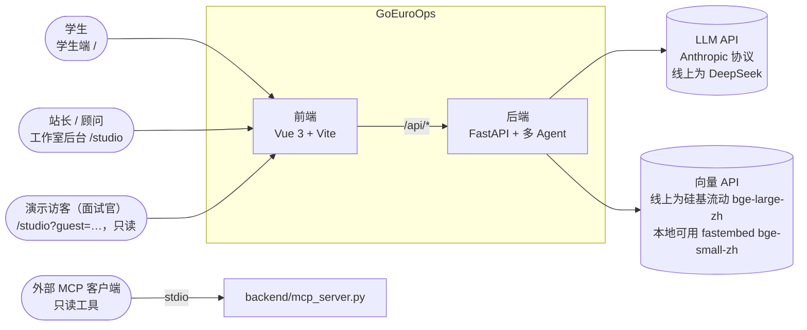

- 模型走 Anthropic 协议，通过 `ANTHROPIC_BASE_URL` 和 `ANTHROPIC_MODEL` 切到 DeepSeek 等兼容服务。
- `mcp_server.py` 只暴露价目、报价、国家资料、付款政策四个只读工具，和内部 Agent 共用定义与网关。它的依赖和后端冲突，不进后端镜像。

## 3. 部署架构

线上是一台 1.6 GiB 内存的阿里云小服务器，和个人主页、Vparser 共用。

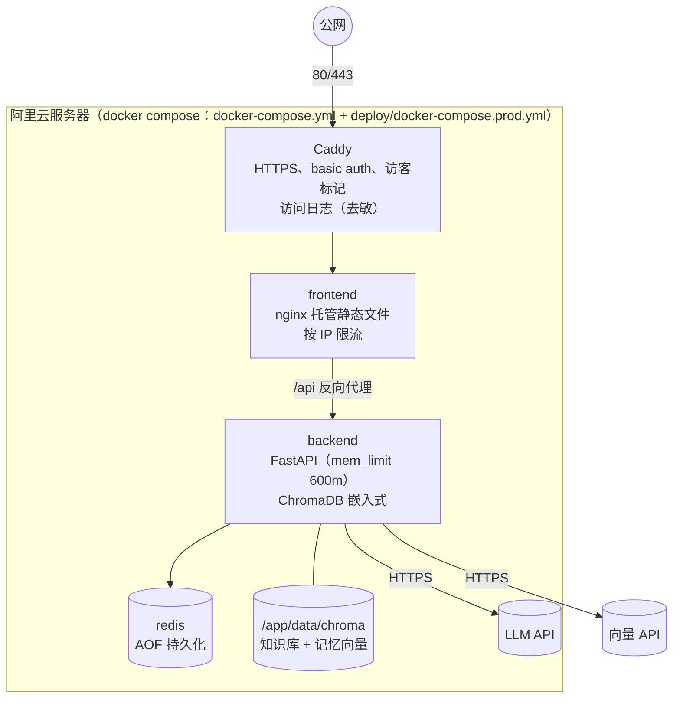

| 环境 | 差别 |
|---|---|
| 本地 `docker compose up -d --build` | 起 backend、frontend、redis、chromadb（独立服务）、prometheus；向量默认本地 fastembed |
| 线上（prod 覆盖文件） | 加 Caddy；后端和前端不暴露端口；ChromaDB 改嵌入式（`CHROMA_HOST=""`）；向量走 API；chromadb、prometheus 放进 profile 默认不起；后端限内存 |

**服务器上不能构建镜像**（内存不够，会把 SSH 一起卡死）。发布方式见第 19 节。

## 4. 后端分层与依赖规则

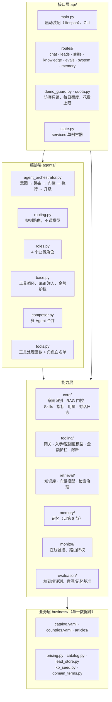

**依赖规则**

- 只能上层依赖下层。`business/` 不导入 `agents/`、`api/`；`core/` 不导入 `agents/`。`agents/routing.py` 读 `business/domain_terms.py` 是允许的，属于往下依赖。
- 运行时单例都放在 `api/state.py` 的 `services` 里，由 `api/main.py` 的 lifespan 装配。新组件也在这里装配，不要在模块导入时创建连接。
- 调用模型统一用 `core/llm_utils.make_client(…, source)`，用量会按来源记进 `core/llm_usage`，花费上限依赖这个统计。
- 拼进提示词的外部文本统一过 `safe_text`。

## 5. 一次对话的完整链路

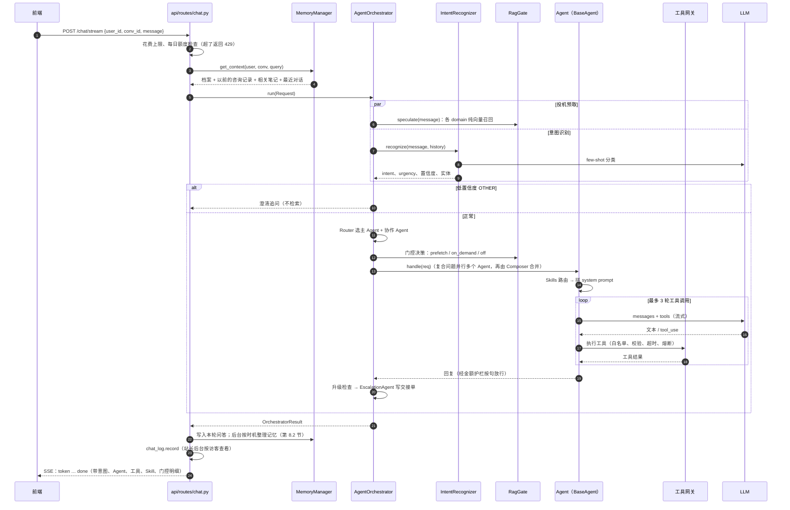

`/chat` 和 `/chat/stream` 共用 `_run_chat`。只有单 Agent 路径是逐 token 转发；澄清追问和多 Agent 合并是拿到全文后一次转发。专属 Agent 流到一半失败、改由 GeneralAgent 回答时，先发一个 `reset` 事件让前端清掉半段文字。

**提示词的组成**（`agents/base.py::_call_llm`），按顺序：

| 位置 | 内容 | 来源 |
|---|---|---|
| tools | 角色白名单 + `read_skill_reference`（该 Agent 有带资料的 Skill 时固定挂上）；**每轮不变** | `roles.py`、`agents/tools.py` |
| system | 角色提示词 + 角色契约 + 常驻 Skill（`mode: always`）+ 回答语言；**每轮不变** | `roles.py`、`core/skill_loader.py` |
| user / assistant 对 | `[动态 Skills]` 本轮按需命中的 Skill（含 references 目录）；门控 off 时加 `[本轮说明]` | `core/skill_loader.py` |
| | `[背景信息]` 记忆上下文 | `memory/` |
| | `[结构化实体]` 意图识别抽出的实体 | `core/intent_recognizer.py` |
| | `[角色输入契约]` 本角色需要的输入和输出要求 | `roles.py` |
| | `[知识库上下文]` 门控预取的片段 | `core/rag_gate.py` |
| user | 本轮用户消息 | |

**为什么这么排**：前缀缓存从第一个不同的 token 开始失效，所以每轮不变的放前面，会变的放后面。工具定义排在最前，所以门控 off 时不拿掉检索工具，而是让它直接返回“本轮不需要检索”；`read_skill_reference` 也固定挂着，只能读本轮命中的 Skill。按需 Skill 放在消息的第一对：同一意图的用户命中同一组 Skill，比记忆和知识库更稳定。实测（`deepseek-v4-flash`，咨询 Agent 8 条请求，缓存冷启动）首轮输入的缓存命中率从 43% 到 73%；缓存热了以后两版都在 92% 左右，因为每个 Agent 的 Skill 组合只有几种。命中情况看 `goeuroops:usage:<日期>` 里的 `cached` / `in`。

## 6. 意图识别、路由与意图门控 RAG

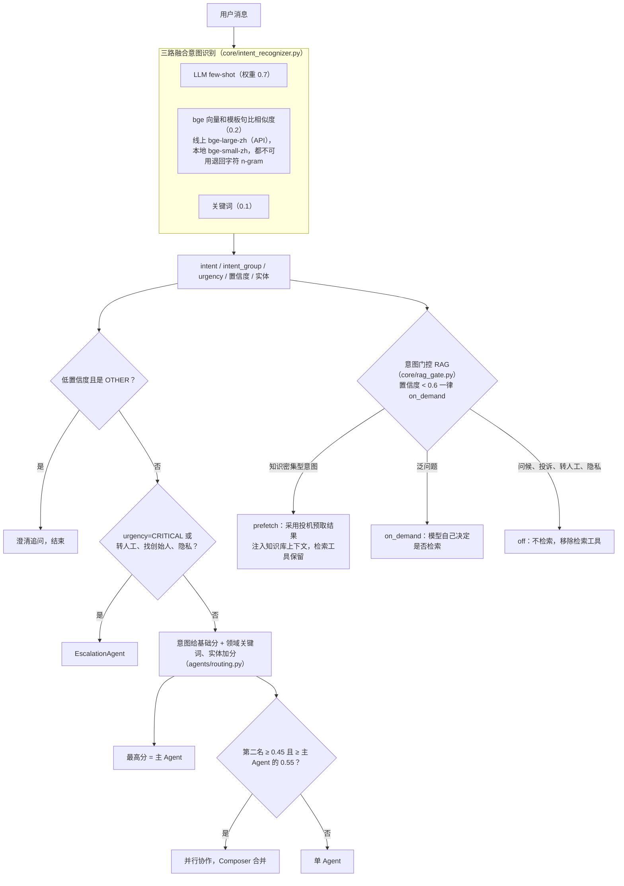

- **意图体系**在 `core/intent_categories.py`，共 19 个值，包括通用大类（query、request、complaint 等）和细粒度业务意图（study_consult、service_inquiry、refund、data_privacy 等），细粒度优先。
- **意图到 Agent 的映射**在 `agents/routing.py` 的 `_GENERAL_INTENTS`、`_CONSULTING_INTENTS`、`_BILLING_INTENTS` 三个集合里。
- **领域关键词**集中在 `business/domain_terms.py`，意图识别和路由共用。
- **提示词**：19 类名单、18 类各一条模板示例（other 没有）、9 个细分意图的一句话判定、**容易混淆的边界规则**（`_BOUNDARY_RULES`，和 `evaluation/datasets/LABELING.md` 一致：问工作室本身 vs 问服务、找真人 vs 找负责人、问“有没有人在线/是不是机器人”不算转人工等）和 10 条边界对比例句（`_BOUNDARY_EXAMPLES`，评测脚本检查它们不和测试样本重复），再加最近 3 轮对话。
- **缓存**：进程内，键是“统一写法后的全文 + 最近 3 轮”的哈希（全角转半角、合并空白、去句末标点、小写；发给大模型的仍是原话），满 1000 条整批淘汰最早的 500 条。**大模型那一路失败时的降级结果不缓存**。命中情况看 `GET /intent/stats` 和 `goeuroops_intent_cache_total{result,turn}`（`turn` 分开场第一句和后续轮次）。
- **基准**（`evaluation/intent_benchmark.py`）：每类按文本哈希固定分成调试集和留出集各 10 条（`--split dev|holdout`），改提示词只看调试集错例，效果只认留出集；报告另算误转人工率和漏转人工率。线上配置（deepseek-v4-flash + bge-large API）在留出集上：边界规则加入前 90.0%，加入后 96.3%–96.8%，误转人工 3 条 → 0 条，漏转人工 1 条（“有真人吗”），分歧检测触发 0 次；大模型失败时的降级准确率 69.5%–69.7%（bge-small 是 59.2%）。
- **在线降权**：`monitor/` 每 10 秒把各 Agent **最近 5 分钟**（最多 50 次、至少 5 次）的成功率和首字耗时折算成惩罚写回编排器（`update_routing_penalties`）。同类有多个实例时选表现好的；每类只有一个实例，所以咨询或费用 Agent 的惩罚达到 0.5（`GOEUROOPS_MONITOR_FALLBACK_PENALTY`）时，Router 把这一类从本次路由里拿掉，问题交给 GeneralAgent，`routing_reason` 记 `monitor_fallback=[...]`。只靠延迟最多罚 0.4，单纯变慢不会触发；成功率掉到 65% 以下才会。被排除后没有新样本，窗口清空后惩罚归零，自动重新接流量。
- **执行失败回退**：专属 Agent 这一次失败时改由 GeneralAgent 回答，两次尝试的工具轨迹都保留，中间插一条 `agent_fallback`。如果失败前已经流出半段文字，SSE 先发 `reset`，前端清掉再接新回答。

## 7. Agent 角色与工具

| 角色 | 负责的意图 | 工具白名单（`roles.py` 的 `tool_scope`） | 必须转顾问的情况 |
|---|---|---|---|
| GeneralAgent 前台接待 | 问候、一般查询、服务进度、反馈、投诉、账号、其他 | `search_knowledge_base`、`inspect_request_context`、`suggest_required_fields`、`get_studio_profile` | 超出前台范围的个性化请求 |
| ConsultingAgent 留学咨询 | 五国知识、申请流程、服务与报价、预约 | `search_knowledge_base`、`lookup_country_admissions_overview`、`lookup_service_offering`、`quote_service_bundle`、`create_consultation_lead` | 个性化选校、文书修改、录取判断 |
| BillingAgent 费用售后 | 费用、退款、发票、付款异常 | `search_knowledge_base`、`check_payment_fields`、`calculate_refund`、`get_payment_policy`、`compare_amounts` | 实际发起退款；多付或付款成功但服务未确认；发票作废重开；对退款金额有异议 |
| EscalationAgent 转顾问 | 要求真人、找创始人、紧急、投诉升级、隐私删除 | `create_handoff_summary`（在 `handle()` 里直接调用，不经模型） | — |

- Agent 有带 references 的 Skill 时，固定挂一个 `read_skill_reference` 工具（工具列表每轮不变，见 5 节“为什么这么排”），只能读本轮已命中 Skill 的资料。
- 门控为 `off` 时，`search_knowledge_base` 会从本轮工具列表里移除。
- 工具定义：入参是 `tooling/schemas.py` 里的 Pydantic 模型，发给模型的 JSON Schema 由模型自动生成；处理函数在 `agents/tools.py`。

## 8. 记忆模块

代码在 `backend/memory/`，入口是 `MemoryManager`（`manager.py`）。设计是客服系统常见的分层记忆，检索层用 A-Mem 笔记（arXiv 2502.12110）。
选型依据见 [CHANGELOG-2026-10 第 3 节](CHANGELOG-2026-10.md)：

- 纯分层（原话只按原文检索）在 LoCoMo 上比 A-Mem 差，所以检索层保留了 A-Mem 笔记；
- 客服能力（咨询记录、档案、证件号、删除）叠在上面。

### 8.1 分层

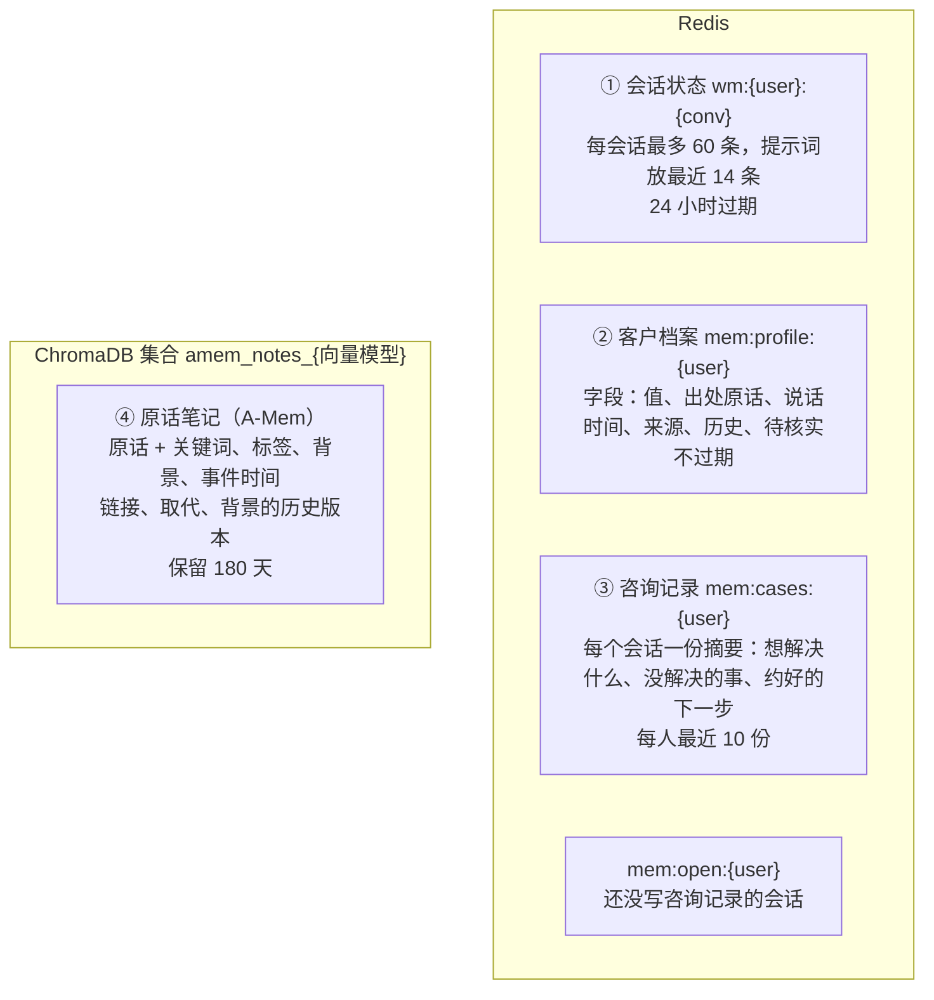

| 层 | 回答什么问题 | 谁来写 | 怎么取 |
|---|---|---|---|
| ① 会话状态 | 刚才在聊什么 | 每轮直接写，不调模型 | 当前会话最近 14 条 |
| ② 客户档案 | 用户是什么情况（专业、GPA、语言成绩、目标国家/城市、入学时间、预算、毕业时间、经历、偏好） | 模型提候选，**代码决定合并**；顾问可以改 | 整份放进提示词 |
| ③ 咨询记录 | 以前聊到哪、还有什么没办完、约了什么 | 会话停下来后由模型写 | 最近 2 份（不含当前会话） |
| ④ 原话笔记 | 档案以外的细节、原话出处、时间线 | 每句陈述立刻原样存；整理时补全 | 向量检索前 6 条，顺链接多取最多 3 条 |

**档案的合并规则**（`profile.py::apply_candidate`）：

- 后说的覆盖先说的，旧值进历史。
- 说话时间更早、但补全晚到的候选，只进历史。
- 顾问核实过的字段（`source=advisor`），模型不能覆盖；用户后来的不同说法记为“待顾问核实”。
- 经历和偏好可以有多条，全部保留。

### 8.2 写入和整理

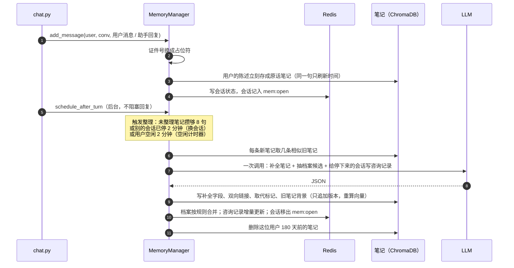

- 当前会话还在进行时，只补全笔记，不写咨询记录。
- 同一会话停下来后又接着聊，下次整理只看新消息，在原摘要上更新。
- 模型输出无效时，原话保留，下次再整理；失败 2 次后放弃补全这几条，它们照样能检索。没写成的咨询记录留在 `mem:open`，下次再写。

### 8.3 读取：提示词里的记忆

`get_context` 并行读四层，`MemoryContext.to_prompt_text()` 按下面的顺序拼成 `[背景信息]`：

```text
[客户档案]（用户自己说的，未核实；付款、订单、报价以系统查询结果为准；括号里是以前的说法）
- 目标国家：瑞典（之前：荷兰）
[以前的咨询记录]（最近的在前）
- 2026-10-12｜想了解文书服务；还没解决：定预算；约好的下一步：周四 20:00 视频
[用户以前说过的相关原话]（按说话时间先后）
- [2025-07｜说于 2026-10-04] 我去年夏天考了雅思 6.0（背景：…）（后来有更新，以新的为准）
[最近对话]
user: …
assistant: …（助手回复截到 300 字）
```

总长超过 6000 字时，先去掉最早的笔记，再去掉较早的咨询记录；档案和最近对话不裁。

### 8.4 降级、隐私和顾问接口

- **降级**：Redis 读写超时 1 秒，失败就按“没有记忆”继续；笔记检索最多等 5 秒，向量查询报错时在这位用户的笔记里精确计算距离。任何失败都不影响回答。
- **证件号**：身份证号、护照号在写入任何一层之前就换成 `[证件号已隐去]`。
- **顾问接口**（线上靠 Caddy basic auth 保护，访客 403）：

| 接口 | 作用 |
|---|---|
| `GET /memory/{user_id}/profile` | 档案原样返回，带出处和历史 |
| `PUT /memory/{user_id}/profile/{slot}` | 顾问核实后改一个字段，之后模型不能覆盖 |
| `DELETE /memory/{user_id}` | 隐私删除：会话、档案、咨询记录、笔记、后台对话记录全部删除。线索和交接单是业务记录，由顾问在线索面板处理 |

- **交接单**：`build_handoff_summary` 把客户档案和以前的咨询记录写进 `background`，线索面板直接显示，顾问不用翻聊天记录。

### 8.5 评测

| 评测 | 测什么 | 命令 |
|---|---|---|
| 基础 + 难题 30 题 | 早期事实、滑出窗口、改主意、历史值、跨会话、不编造、多事实、长消息、长对话 | `python -m evaluation.memory_benchmark --runs 3` |
| 压力题 10 题 | 闲聊干扰、多会话、反复修改、相对时间、多跳 | `--set stress` |
| 客服题 8 题 | 回访接上没解决的事、助手约好的下一步、顾问承诺、证件号不被记住、不编造约定 | `--set service` |
| LoCoMo 70 题 | 公开长对话记忆数据集（英文） | `python -m evaluation.locomo_benchmark --data locomo10.json --convs 0,1 --per-cat 10` |

- 环境变量 `GOEUROOPS_MEMORY_MODULE` 可以切换评测的实现，方便和旧版同题对比：在旧版的工作树里设成 `memory.amem`。
- 当前结果（deepseek-v4-pro）：
  - 30 题、压力题、客服题都是 100%；
  - LoCoMo 3 次平均 49.0%，旧版 45.3%。
- 每次整理调用的 token 约为旧版的 2.5 倍。

**改记忆模块的规则**：新版必须和当前线上版本用同一个模型、同一套题对比，几项都不比旧版差才能上线。LoCoMo 单次波动有 10 个百分点左右，至少跑 3 次取平均。

## 9. 业务流程

### 9.1 报价

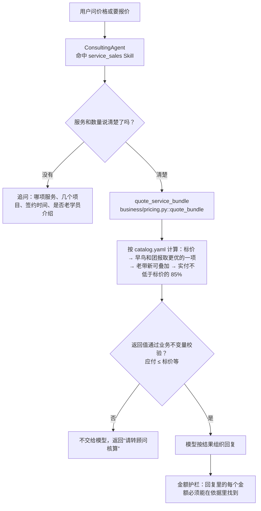

### 9.2 线索登记

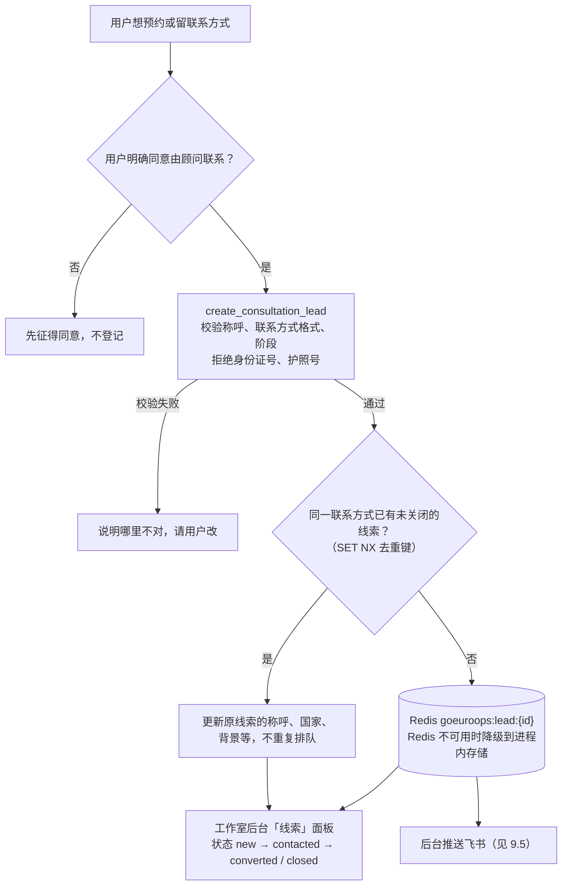

### 9.3 退款估算

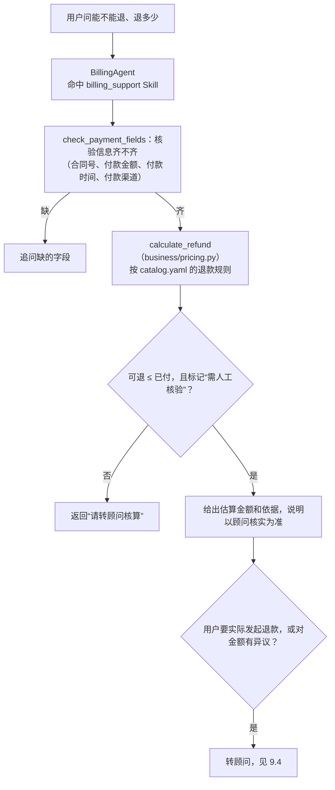

### 9.4 转顾问（升级）

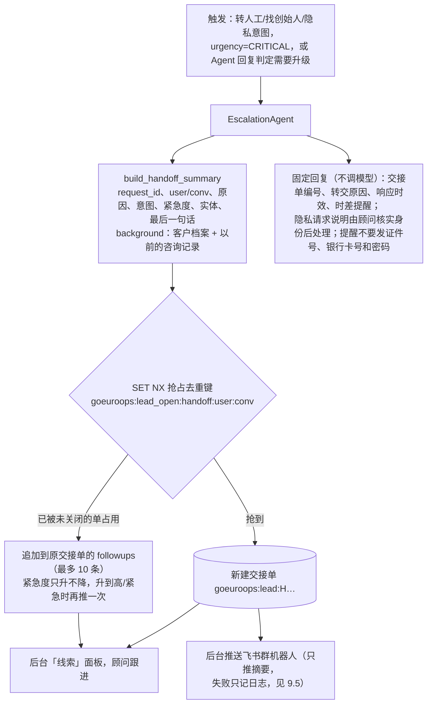

- **去重是原子的**：查重和建单靠 Redis `SET NX` 一步完成，用户连点两次“转人工”、两个请求同时到达，也只建一张单。顾问把单改成 `converted` / `closed` 时释放去重键，同一会话再要求真人会开新单。咨询线索同理，按“渠道 + 联系方式”去重（键里只放哈希），重复登记时用新值覆盖称呼、目标国家、背景等字段。

### 9.5 新单推送（飞书）

`business/notifier.py`：线索库建了新线索或交接单后，在后台把摘要推到飞书群自定义机器人，顾问不用一直盯着线索面板。

- **只推摘要**：交接单推原因、意图、紧急度、截短并去掉证件号的最后一句话；线索推称呼、脱敏联系方式、目标国家和入学时间；都带线索面板链接。客户档案（`background`）和完整聊天不出站。
- **不拖慢对话**：推送是后台任务，回复不等它；失败只记日志和 `goeuroops_lead_notify_total{type,outcome}`，交接单照样在线索库里。连续失败 5 次熔断 60 秒（同一个 `CircuitBreaker`）。
- **签名**：开启机器人的“签名校验”时，按飞书规则用 `timestamp\nsecret` 做 HmacSHA256；飞书出错时 HTTP 也是 200，要看返回体的 `code`。
- **配置**：`GOEUROOPS_FEISHU_WEBHOOK`（不设就不推）、`GOEUROOPS_FEISHU_SECRET`、`GOEUROOPS_LEADS_PANEL_URL`，都放服务器 `.env`。评测用的编排器用内存线索库，不推送。

## 10. 业务目录：单一数据源

`business/catalog.yaml`（服务、价格、优惠、付款退款发票政策）和 `business/countries.yaml`（五国资料，带官网链接和核实日期）驱动：

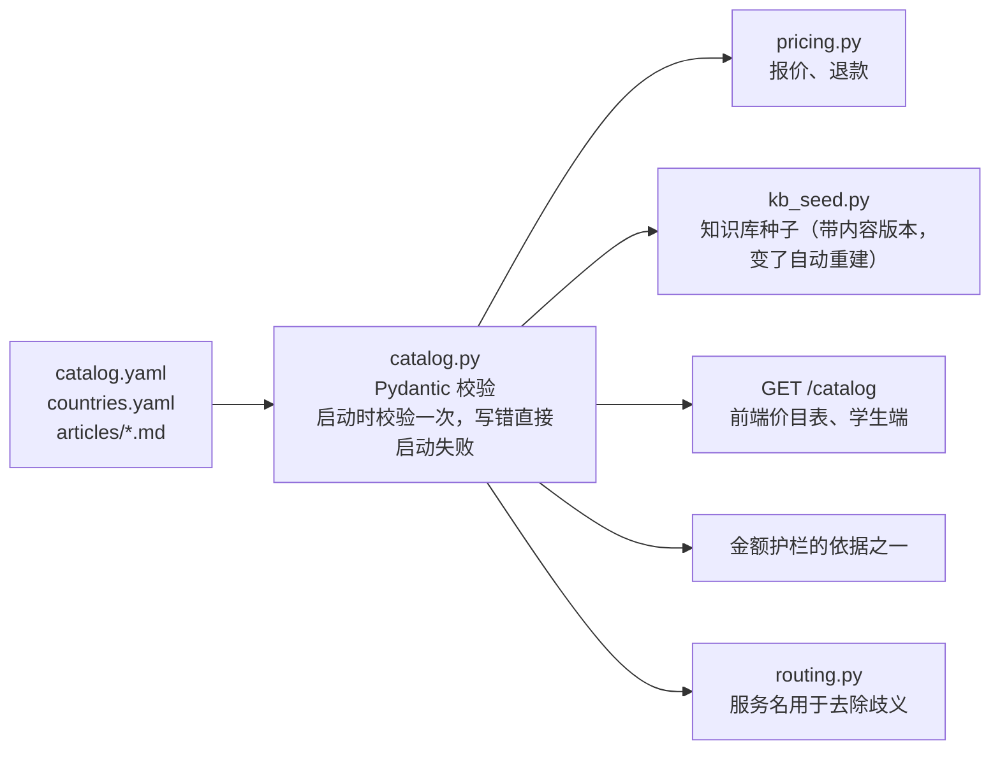

**价格随时改，不写死在代码里**：`catalog.yaml` 里是默认价；站长在后台“服务价目”页点“改价格”，保存后调 `PUT /catalog/prices`，新价格写进数据卷里的覆盖文件（`GOEUROOPS_PRICE_OVERRIDES`，默认 `/app/data/price_overrides.json`），立即生效：报价、退款、助手回答都用新价，知识库里的服务介绍随之重新同步，检索缓存清掉。改回默认价就去掉那条覆盖。覆盖文件在数据卷里，重启和部署都不会冲掉，也不会让服务器上的代码目录出现未提交改动。前端（含学生站）不写任何价格，全部从 `GET /catalog` 读。

政策、国家资料和默认价仍改 YAML。线上 `business/` 挂载进容器，改完 `docker compose restart backend` 即可，不用重建镜像。

## 11. Skills

Skill 是可热加载的业务规范（话术、流程、边界、升级条件），结构对齐 Anthropic Agent Skills 的渐进式披露：

```text
backend/skills/<skill_id>/
├── SKILL.md          front matter（agents、intents、keywords、examples、version）+ 核心规则，命中后注入 system prompt
├── references/*.md   详细资料，只列目录，模型需要时用 read_skill_reference 读
└── evals/cases.json  命中回归用例（该命中 / 不该命中的句子）
```

| Skill | 绑定 Agent | 绑定意图 |
|---|---|---|
| `studio_brand_voice` | 全部（`mode: always`） | — |
| `general_reception` | general | greeting、query、request、feedback、complaint、service_progress、account、other |
| `study_consulting` | consulting | study_consult、application_process |
| `service_sales` | consulting | service_inquiry、booking |
| `billing_support` | billing | billing、refund、invoice、payment_issue |

**路由是确定性的**，不额外花一轮模型调用：意图绑定（0.5）+ 关键词 + 语义样例（本地 n-gram 向量）+ 会话粘性，超过阈值（默认 0.35）就注入，总字数上限 6000。热加载用 `POST /skills/reload`。

## 12. 知识库与检索

Agent 的知识来源有两套，用 `GOEUROOPS_KNOWLEDGE_BACKEND` 切换：`wiki`（默认，12.1）和 `rag`（原方案，12.2，保留用于回退和对比，另有备份分支 `rag-backup`）。两套对外都是 `search_fast`（门控预取）和 `search_with_rewrite`（`search_knowledge_base` 工具）两个入口，编排器、门控、Agent 和 trace 都不区分。

### 12.1 LLM Wiki（线上默认）

思路来自 Karpathy 的 LLM Wiki：知识先整理成按主题组织的页面，回答时读目录、翻整页，而不是每次从切碎的片段里现找。按这个项目的场景改造了三处：

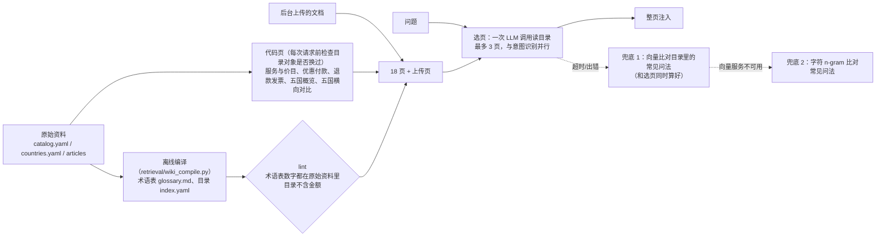

- **结构化数据由代码生成，不交给 LLM**：服务、价格、优惠、退款、国家资料这些页面每次从 YAML 现场组装（`retrieval/wiki.py` 的 `build_pages`），后台改价后 `get_catalog()` 换成新对象，下一次检索前页面就跟着变。LLM 整理时可能抄错数字，而这些页面里的数字最要紧，所以不让 LLM 碰。
- **LLM 只编译两样东西**：目录（每页的摘要和 20 来条“学生会怎么问”）和一页术语表（APS、Studielink、English 6、Sperrkonto 等，每条标注来源）。编译时模型只看原始资料，不看评测集。产物提交进 git，CI 里的 `tests/test_wiki.py` 跑 lint：每页都有目录条目；目录不含金额（价格会变，目录不能跟着过期）；术语表里的每个数字都能在原始资料里找到，引用的来源真实存在；原始资料改了而术语表没重编时报错（以前只警告，过期的术语表会被当知识注入）。另外检查手写文字和结构化数据不矛盾：catalog 的规则文字（几折、定金比例、保底比例）要和字段一致，除老带新外不写死金额；文章不写金额，提到的折扣和定金比例要和 catalog 一致。这条加上时就抓到单次咨询的升级说明写死了“可抵扣 ¥199”，改价后会过期，已改成不写金额。
- **选页不增加一轮往返**：`RagGate.speculate` 在意图识别的同时为三个领域各发起一次预取，wiki 把同一个问题的三次请求合并成一次选页调用（`asyncio.shield`，门控取消没用上的领域时不会把共享请求取消），结果缓存 5 分钟。选页 p50 约 0.9–1.0 秒、p90 约 1.2 秒，意图识别的 LLM 调用 p50 约 1.1 秒、p95 约 1.3 秒，大部分时候被藏住。服务启动时先预热一次，避免冷启动超时（评测时第一批并发请求在冷缓存下有 6 次超过 4 秒）。
- **不按领域过滤**：页面按主题组织，跨领域问题（“全程陪跑交了定金能退吗”）需要跨领域的页。
- **兜底**：选页超时（`GOEUROOPS_WIKI_SELECT_TIMEOUT`，默认 4 秒）或出错时，拿问题去比对目录里每页的常见问法，取最像的一两页。分两层，阈值由 `evaluation/wiki_fallback_calibrate.py` 在线上配置下校准：

  | 兜底 | 依赖 | 阈值 | 注入正确文档 | 无答案误注入 |
  |---|---|---|---|---|
  | 1. 向量（bge-large API，问法和问题对称编码） | 硅基流动，和选页用的 DeepSeek 不是同一家 | 0.6 | 93.5% | 15.4% |
  | 2. 字符 n-gram | 无 | 0.25 | 71.0% | 46.2% |

  问题向量化和 LLM 选页同时发起，LLM 失败时直接用现成的结果，不额外等待；LLM 成功就丢弃。约 450 条问法的向量在启动和目录变化后于后台准备（约 5 秒），准备好之前兜底用 n-gram。阈值是在评测集上选的，有轻微过拟合，只影响兜底路径。
- **上传文档**：ChromaDB 知识库仍然保留，后台上传和删除照旧；wiki 把上传的文档拼回整篇，按 Markdown 标题拆成不超过 4,000 字的几页（以前超长直接截断）。上传后在后台用和内置页同一个提示词编目录条目（摘要 + 常见问法，去掉金额），按内容哈希存在 `GOEUROOPS_WIKI_DATA_DIR`（默认 `/app/data/wiki`），编好之前先用标题和开头一段。上传、删除、改价后都会立即重组页面。
- **线上闭环**：Karpathy 原版会把好的回答存回 wiki；客服的回答不一定对，所以改成人工确认。选页为空或 LLM 失败的问题记进数据目录的 `misses.jsonl`（`GET /knowledge/wiki/misses` 看最近 200 条，访客看到的是打码版）→ `python -m retrieval.wiki_compile --review-misses misses.jsonl` 让模型建议每个问题能归到哪页（写进 `miss_suggestions.yaml`）→ 人工删掉不对的 → `--accept` 并入 `business/wiki/extra_questions.yaml`，加载时并入对应页的常见问法，同样过 lint。

**评测**（`evaluation/knowledge_compare.py`，retrieval_v1 的 106 条标注问题，其中 13 条资料里没有答案）。RAG 组是在线上容器里按线上配置（bge-large-zh + bge-reranker-v2-m3，Top-3）导出的实际注入内容；端到端时两组注入内容交给同一个 Agent（同模型、同 Skill、同工具，不给检索工具），由 deepseek-v4-pro 以全部原始资料为参考盲评（A/B 顺序随机）。端到端跑了两遍（不同随机种子）：

| 指标 | RAG | Wiki |
|---|---|---|
| 注入内容里有正确文档（93 条有答案） | 85.0% | 98.9% |
| 无答案问题被注入内容（13 条，越低越好） | 15.4% | 0% |
| 口语化问法注入命中（20 条） | 75.0% | 95.0% |
| 平均注入字数 | 475 | 约 1,100 |
| 检索耗时 p50（和意图识别并行） | 564 ms | 885–1,011 ms |
| 回答完全正确率 | 87.7% / 88.7% | 95.3% / 94.3% |
| 回答编造资料外具体事实 | 4.7% / 3.8% | 0.9% / 0.9% |
| 盲评胜负（其余为平） | 18 / 16 | 24 / 34 |
| Agent 耗时 p50 | 2,144 / 2,047 ms | 2,108 / 1,961 ms |

两遍合计 wiki 胜 58、RAG 胜 34（符号检验 p ≈ 0.02）。RAG 胜的题大多是“补充信息更多”，不是答错；13 条无答案题上两边持平。代价是每条消息多一次小模型调用（目录约 8,000 字，前缀会被服务商缓存）和多一倍注入字数。

评测还发现一个和检索无关的线上问题：#21 降价后，三个 Skill 里还写着旧价格（单次选校咨询 ¥699 等），两组回答都出现过把旧价说给用户的情况。已在 #23 修复，并加了测试禁止 Skill 写死金额。

### 12.2 向量 RAG（`GOEUROOPS_KNOWLEDGE_BACKEND=rag`）

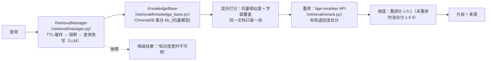

- **两条入口**：门控 `prefetch` 时在意图识别的同时做向量召回 + 重排（不改写），重排的几百毫秒被意图识别藏住；模型主动调用 `search_knowledge_base` 时再加上 LLM 查询改写。
- **重排**（`retrieval/rerank.py`）：调硅基流动的 `/rerank`（`BAAI/bge-reranker-v2-m3`，和向量 API 共用密钥），候选取前 8 篇文档，给“问题-片段”打 0–1 分。接口超时（1.5 秒）、出错或熔断（连续 3 次失败，60 秒后探测）时退回混合分排序，结果里 `reranked=false`。环境变量：`GOEUROOPS_RERANK=off` 关闭，`GOEUROOPS_RERANK_MODEL`、`GOEUROOPS_RERANK_MIN_SCORE`（默认 0.1）、`GOEUROOPS_RERANK_TIMEOUT`。
- **阈值看分数来源**（`passes_threshold`）：重排过的看重排分（默认 0.1），没重排的看混合分（`GOEUROOPS_RAG_PREFETCH_MIN_SCORE`，默认 0.4）。两种分数刻度不同，不能共用一个阈值。0.1 是按检索评测集的逐条分数选的：0.2 能把无答案误注入压到 7.7%，但正确文档的注入率从 82.8% 降到 77.4%；漏注入时模型还能自己检索，所以取 0.1。
- **追问补全**（`core/rag_gate.py` 的 `retrieval_query`）：当前这句不超过 12 字、并且以“那/这个/还有”开头或以“呢”结尾时，把上一轮用户的话拼在前面再检索（规则，不调模型，因为预取和意图识别并行）。深查链路把上一轮用户的话交给查询改写，重排也按补全后的问题打分。
- **降级结果不当证据**：知识库超时、出错或熔断时，两条入口都把降级条目滤掉。预取得到空结果；检索工具返回 `success=false` 和“知识库暂时不可用”，由模型告诉用户稍后再问或请顾问确认。
- **向量模型**（`retrieval/embeddings.py`）：本地默认 fastembed bge-small-zh（ONNX，约 90MB）；线上用向量 API（bge-large-zh），省内存。换模型时集合名跟着变，两个模型的数据不会混在一起。
- **文档生命周期**（`KnowledgeBase._upsert_document`）：每篇文档有稳定的 `doc_id`（导入时可以指定，不指定就按“来源 + 标题”生成）和内容版本 `doc_version`。再导入同一篇文档时，内容没变就跳过（不重复向量化）；变了就**先写新版本，写成功后再删旧版本**，库里不会新旧并存，向量化中途失败也会保留旧版本。
- **种子**由 `business/kb_seed.py` 从业务目录生成。启动时逐篇比对版本：没变的跳过，变了的替换；全部写成功后才删掉业务目录里已经没有的种子和早期示例文档。向量 API 不可用时，旧种子原样保留。
- **上传文档**：`/knowledge/add`、`/knowledge/upload` 导入；`GET /knowledge/documents` 按文档列出（版本、片段数），`DELETE /knowledge/documents/{doc_id}` 删除（种子文档不能删，改业务目录即可）。导入和删除后都会立刻清空检索缓存。

## 13. 工具网关与金额护栏

所有 Agent 工具都走 `tooling/gateway.py`，执行顺序固定：

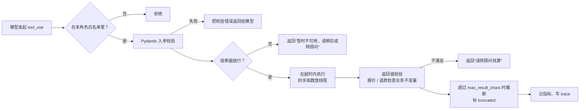

每个工具在定义时声明 `timeout_s`、`side_effect`（read / write / external）、`breaker`、`max_result_chars`。

**熔断器**（`tooling/breaker.py`，网关和检索管理器共用）：连续失败 5 次打开，60 秒后半开，**只放行一个探测请求**，探测成功关闭、失败重新打开；探测被取消、迟迟不回时，过 60 秒再放一个。每次状态切换都换一代 ticket，调用结束时交回 ticket，旧 ticket 的结果直接忽略，所以熔断前发出、熔断后才返回的慢请求不会把熔断器提前关上。

**金额护栏**（`tooling/amount_guard.py`）：回复里出现的人民币金额，必须能在本轮依据里找到。依据包括工具结果、用户原话、背景、知识库片段、Skill 和价目表。找不到时，这一句被替换成固定提示。中文数字写的金额（“三千元”“一万二千块钱”“3千元”）也认，用户说“预算三千”时模型写“3,000 元”算有依据；“几千元”“上千元”这类约数不算具体金额。流式输出按句放行，不会先发出错误数字再撤回。由 `GOEUROOPS_AMOUNT_GUARD` 控制：`enforce`（默认）/ `warn` / `off`。

## 14. 数据存储清单

| 存储 | 键 / 集合 | 内容 | 保留 | 写入方 |
|---|---|---|---|---|
| Redis | `goeuroops:lead:<id>`、`goeuroops:leads` | 线索和交接单、索引 | 不过期 | `business/lead_store.py` |
| Redis | `goeuroops:lead_open:<handoff:user:conv / lead:哈希>` | 去重键：指向还在跟进的那张单 | 30 天，关单时删除 | `business/lead_store.py` |
| Redis | `goeuroops:chatlog` | 每轮问答（站长后台按访客查看） | 最近 2000 条 | `core/chat_log.py` |
| Redis | `goeuroops:usage:<北京日期>` | 按天、按来源的调用数、token、费用估算 | 120 天 | `core/llm_usage.py` |
| Redis | `goeuroops:quota:chat:<日期>`、`goeuroops:quota:guest_eval:<日期>` | 每日对话、访客评测次数 | 当天 | `api/quota.py` |
| Redis | `wm:<user>:<conv>` | 会话消息（最多 60 条） | 24 小时 | `memory/` |
| Redis | `mem:profile:<user>`、`mem:cases:<user>`、`mem:open:<user>` | 客户档案、咨询记录、待写记录的会话 | 档案不过期；记录每人 10 份 | `memory/` |
| ChromaDB | `kb_<向量模型>` | 知识库片段 | 按文档版本增量同步，先写后删 | `retrieval/knowledge_base.py` |
| ChromaDB | `amem_notes_<向量模型>` | 原话笔记（A-Mem） | 180 天 | `memory/` |
| 文件 | `business/*.yaml`、`business/articles/`、`backend/skills/` | 业务目录、文章、Skills | Git | 人工 |
| 文件 | `/app/data/eval/baseline.json` | 评测基线 | 卷 | `evaluation/evaluator.py` |
| 文件 | Caddy 访问日志 `/data/logs/` | 去掉口令和 Cookie 的访问记录 | 90 天 | Caddy |

- 线上 Redis 开了 AOF，数据在 `redis-data` 卷里。
- ChromaDB 线上是嵌入式，数据在后端的数据卷里。
- 生产数据只通过应用接口查看，不直接读库。

## 15. 接口清单

网关路径前缀是 `/api`，下表省略。管理类接口没有应用层口令，线上靠 Caddy basic auth（第 17 节）保护。

| 分类 | 接口 | 说明 | 访客可写 |
|---|---|---|---|
| 对话 | `POST /chat`、`POST /chat/stream` | 一次性 / SSE 流式；响应带意图、Agent、工具、Skill、门控明细 | ✓（计入额度） |
| 业务 | `GET /catalog` | 价目、默认价、优惠、政策、五国资料 | — |
| 业务 | `PUT /catalog/prices` | 站长改价，立即生效并同步知识库 | ✗ |
| 线索 | `GET /leads`、`PATCH /leads/{id}` | 线索和交接单；访客看到的联系方式打码 | ✗ |
| 记忆 | `GET /memory/{user_id}/profile`、`PUT /memory/{user_id}/profile/{slot}`、`DELETE /memory/{user_id}` | 看档案、顾问核实改字段、隐私删除 | ✗ |
| Skills | `GET /skills`、`GET /skills/{id}`、`POST /skills/reload`、`POST /skills/match`、`GET /skills/evals` | 查看、热加载、命中测试、跑回归用例 | 仅 match |
| 知识库 | `POST /search`、`POST /knowledge/add`、`POST /knowledge/upload`、`GET /knowledge/documents`、`DELETE /knowledge/documents/{doc_id}`、`GET /knowledge/stats` | 检索、导入（同一文档再导入即替换）、按文档列出和删除、统计 | 仅 search |
| 评测 | `POST /eval/run` | 意图、Skill 路由、五维质量、工具调用、门控对照 | ✓（每天限次，只跑内置用例） |
| 观测 | `GET /monitor`、`GET /trace/tool/{request_id}`、`GET /trace/tools`、`GET /tools/stats`、`GET /intent/stats`、`GET /metrics` | 在线指标、单次请求明细、Prometheus | — |
| 系统 | `GET /session`、`GET /health` | 当前身份（guest / owner）、健康检查 | — |

**新增写接口默认只对站长开放**：访客能调用的写接口是白名单（`api/demo_guard.py::GUEST_WRITE_ALLOWED`），不在名单里的一律 403。

## 16. 前端

```text
frontend/src/
├── Root.vue                路径以 /studio 结尾进后台，否则进学生端；两边各自一个 chunk，全局样式互不影响
├── student/                学生端：StudentSite（五国和服务介绍）、ChatPanel（对话）、北欧天空动画
├── App.vue                 工作室后台：对话调试 / 线索 / 服务价目 / Skills / 知识库 / 评测 六个标签
├── components/             LeadsView、CatalogView、SkillsView、LangSwitch
└── lib/                    backends.js（API 调用、设置存 localStorage）、i18n.js + en.js（中英双语）、labels.js、markdown.js
```

- 后台启动时调 `GET /session`，访客模式下禁用写操作，并显示每日额度提示。
- 本地开发：`cd frontend && npm run dev`，Vite 把 `/api` 代理到 `localhost:8000`。
- 文案改动要同时改中文和 `lib/en.js`。CI 会构建前端，导入写错会直接失败。

## 17. 公开演示的安全与成本控制

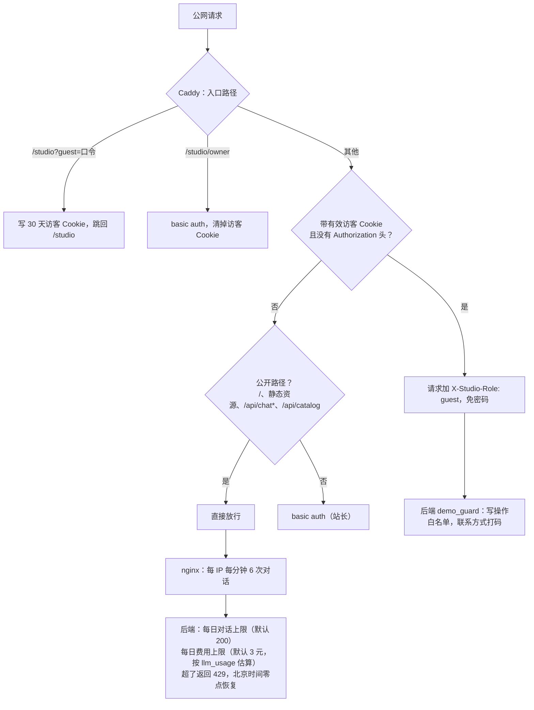

- 外部请求自带的 `X-Studio-Role` 会先被 Caddy 删掉，所以访客身份无法伪造。
- 访客链接的口令少于 16 位时，整个访客通道失效。
- 换口令即可让旧的访客链接作废。

## 18. 观测与评测

**在线观测**

- 每次回答都带 `skills_applied`、`rag_gate`、`tools_used`、`routing_reason`。完整明细可以用 `GET /trace/tool/{request_id}` 查到。
- `monitor/performance_monitor.py` 定期采集 Agent 和工具的统计，用 Z-score 检测突变，可选 Webhook 告警，并把最近 5 分钟的成功率、首字耗时写回路由（第 6 节）。

几个字段容易读错：

| 字段 | 实际含义 |
|---|---|
| `knowledge_used` | 本轮门控预取到了片段，或检索工具真的查到了内容（查空、知识库降级都不算）；不代表回答真的用了这些片段 |
| `primary_agent` 和 `agent_type` | 前者是路由的决定，后者是实际给出回答的 Agent；专属 Agent 失败回退后两者不同 |
| trace 里的 `success` 和 `result_success` | 前者表示网关执行没出错（白名单、校验、超时、熔断都过了），后者是工具自己返回的 `success`；知识库查空或降级时前者为真、后者为假 |
| trace 里的 `amount_guard`、`agent_fallback` | 不是真的工具调用，是金额护栏改写、专属 Agent 回退的事件记录 |
- 主要的 Prometheus 指标有 `goeuroops_tool_calls_total{tool,outcome}`、`goeuroops_tool_latency_seconds`、`goeuroops_amount_guard_total`、`goeuroops_lead_notify_total{type,outcome}`。

**离线评测**（`backend/evaluation/`）

| 工具 | 测什么 | 怎么跑 |
|---|---|---|
| `evaluator.py` | 意图准确率、Skill 路由准确率、五维 LLM-as-Judge（按场景的期望行为校准，含边界合规）、工具调用检查、门控 A/B、与基线对比 | 后台「评测」或 `POST /eval/run` |
| `intent_benchmark.py` | 意图识别基准：380 条，调试集 / 留出集各半，准确率、Macro-F1、领域准确率、误转人工 / 漏转人工、消融 | `python -m evaluation.intent_benchmark --split holdout` |
| `retrieval_benchmark.py` | 知识库检索：106 条（含多轮追问、知识库里没有答案的问题），文档级 Hit@1/Hit@3/MRR、注入命中率、无答案误注入率 | `python -m evaluation.retrieval_benchmark [--deep]` |
| `tool_benchmark.py` | 工具选择：39 条，走完整链路，统计完全正确率、必调召回、多调、误调禁用工具、平均调用次数（标注规则见 `datasets/LABELING.md`） | `python -m evaluation.tool_benchmark` |
| `memory_benchmark.py`、`locomo_benchmark.py` | 记忆：自建 48 题 + LoCoMo（见 8.5） | 见 8.5 |
| `skills/*/evals/cases.json` | 每个 Skill 的命中回归 | `GET /skills/evals`，单元测试里也会跑 |

评测报告写在 `backend/evaluation/reports/`。报告里会记下所用模型，**不同模型的数字不能直接比较**。

`/eval/run` 的口径：
- **评测用单独的编排器**：线上的 Agent 统计、监控降权和 trace 不被评测流量污染；报价登记、转顾问生成的线索和交接单只写进内存。知识库和检索管理器（缓存、熔断）仍然共用，也会消耗真实的模型额度。
- **Judge 评分失败不计分**：输出为空、被截断、JSON 不合法、字段缺失或不在 0–1 都算失败，最多试两次（401/403 不重试）。失败的样本不进均分和通过率，`pass_rate` 的分母是 `scored`。
- **报告状态**：`complete` / `partial`（部分对话评分失败）/ `failed`（对话评分全部失败）/ `empty`。只有 `complete` 才做回归对比、才更新基线。
- **回归只在同一套件之间比**：`suite_id` 是用例、Judge 模型和评测选项的指纹；换了用例或模型就不比，旧基线没有 `suite_id`，第一次跑完整评测后才开始对比。

## 19. 开发、测试与发布

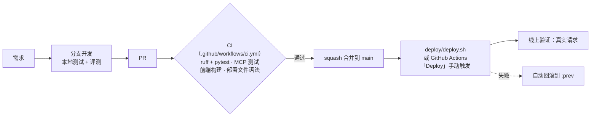

- **main 受保护**：所有改动走 PR → CI → squash。
- **测试**：`cd backend && python -m pytest -q`，不需要真的 Redis 或模型，测试里用的是替身。另外跑 `ruff check .`。
- **发布**：`deploy/deploy.sh [backend|frontend|rollback]`。
  - 先检查本地改动已全部提交、推送，再让服务器 `git pull` 到同一个提交。
  - 前端在本机构建，把 dist 传到服务器。
  - 后端在固定的 `:base` 镜像上叠一层代码，得到新的 `:latest`；旧的 `:latest` 记为 `:prev`。
  - 只重建改动的容器，等健康检查通过，再从公网访问一次。
  - 任何一步失败都自动回滚。
- **依赖变了**（`requirements.txt`、Dockerfile、nginx 配置）不能用叠一层的办法，脚本会停下来提示，需要换 `:base` 镜像。
- **改了什么、怎么生效**：

| 改动 | 生效方式 |
|---|---|
| `backend/skills/` | 已挂载，`POST /skills/reload` |
| `backend/business/` | 已挂载，重启后端；知识库种子按版本自动重建 |
| 其他后端或前端代码 | 走发布流程 |
| `.env` | 重建对应容器 |

## 20. 扩展指南：常见需求改哪里

| 需求 | 要改的地方 | 必须一起做的事 |
|---|---|---|
| 改价格 | 后台“服务价目”页（`PUT /catalog/prices`）；默认价在 `business/catalog.yaml` | 不用改代码；测试从目录取价，不写死数字 |
| 改优惠、退款规则 | `business/catalog.yaml` | 跑 `tests/test_business.py`；规则变了要补用例 |
| 加一项服务 | `catalog.yaml` | 服务名会自动进入路由的去歧义词表；检查 `service_sales` Skill 的话术 |
| 更新五国资料 | `business/countries.yaml`（带官网链接和 `last_verified`） | 知识库种子自动重建 |
| 加一个意图 | `core/intent_categories.py`、`business/domain_terms.py` 关键词、意图识别的 few-shot 示例、`agents/routing.py` 的映射集合、`core/rag_gate.py` 的门控策略 | 跑意图基准；相关 Skill 的 `intents` 也要加 |
| 加一个工具 | `tooling/schemas.py` 入参（和金额类的返回值）模型 → `agents/tools.py` 处理函数和 `AgentToolSpec`（声明超时、副作用、熔断）→ `roles.py` 的 `tool_scope` | 写入类工具要考虑幂等和降级；涉及金额的一定要有返回值不变量；单元测试 |
| 加一个 Agent 角色 | `agents/base.py::AgentType`、`roles.py` 新类（提示词、契约、工具、转交条件）、`agent_orchestrator.py` 注册、`routing.py` 映射、`core/skill_loader.py::VALID_AGENTS` | 评测用例覆盖新角色 |
| 加或改一个 Skill | `backend/skills/<id>/`（按 `skills/README.md`） | 必须带 `evals/cases.json`；`GET /skills/evals` 全过 |
| 加一个后台写接口 | `api/routes/<模块>.py`，在 `api/main.py` 注册；鉴权靠 Caddy basic auth 和访客拦截（`demo_guard`） | 访客默认 403，确实要开放才加进 `GUEST_WRITE_ALLOWED`；涉及个人信息的给访客打码 |
| 加一个新的模型调用 | 用 `make_client(…, source)` | 新来源会出现在用量统计里，花费上限自动覆盖 |
| 改前端文案 | 对应 `.vue` + `lib/en.js` | CI 构建通过 |
| 改部署 | `deploy/`（Caddyfile、prod compose、deploy.sh） | CI 会检查语法；先在本地 compose 验证 |
| 改记忆 | `backend/memory/` | 按 8.5 的规则和线上版本同题对比；`tests/test_memory.py` |

## 21. 已知限制

完整的差距评估和计划见 [ROADMAP-commercial.md](ROADMAP-commercial.md)。和架构相关的主要几条：

- **单机、单进程**：编排器的统计、trace、记忆的后台整理和空闲计时器都在进程内，不能直接横向扩成多副本。要扩容时，这些状态得先移到 Redis 或独立的任务队列。
- **鉴权是演示级别**：站长靠 Caddy basic auth，没有顾问账号体系，CORS 是 `*`。
- **价目和五国资料是草案**，需要创始人逐条核实。
- **LLM Wiki 适合现在的资料规模**（18 页、目录约 8,000 字）。资料涨到上百页时，目录本身会太长，需要先按领域分目录或回到向量召回做粗筛；上传文档没有经过编译，只靠标题和开头一段被选中。
- **`catalog.yaml` 的升级说明里写死了抵扣金额**（“可抵扣 ¥199”），后台改单次咨询价格时这句话不会跟着变。
- **评测只隔离了编排器**：线索写进内存，但知识库、检索缓存和熔断器跟线上共用，评测期间检索出问题会影响线上；评测仍是同步接口，用例多了要等。
- **分歧检测阈值 0.8 是按 bge-small 校准的**。线上的 bge-large 在 0.8 以上精确率 96.2%（26 条），和边界规则加入后大模型的 96% 左右相当，样本太少不足以支持改阈值；分歧检测在线上配置下仍是 0 次触发。
